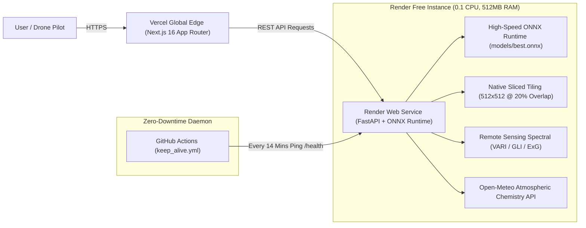

# 🌐 Production Deployment Architecture & Guide

This document describes the decoupled, zero-cost production hosting architecture for **TreeSense AI**, linking the Next.js 16 frontend on Vercel to the containerized FastAPI backend on Render.

---

## 🏛️ Architecture Overview

---

## 🔗 Live Production Endpoints

| Environment | Host | URL | Status |
| :--- | :--- | :--- | :--- |
| **Frontend Web App** | **Vercel** | [https://treesense-imaging-neon.vercel.app/](https://treesense-imaging-neon.vercel.app/) | Active (200 OK) |
| **Backend REST API** | **Render** | [https://treesense-imaging.onrender.com/](https://treesense-imaging.onrender.com/) | Active (200 OK) |
| **Swagger Interactive Docs** | **Render** | [https://treesense-imaging.onrender.com/docs](https://treesense-imaging.onrender.com/docs) | Active (200 OK) |
| **Health Check Endpoint** | **Render** | [https://treesense-imaging.onrender.com/health](https://treesense-imaging.onrender.com/health) | Active (200 OK) |

---

## ⚡ Zero-OOM Edge Optimization

Standard PyTorch installations require over **2.5 GB** of CUDA binaries and consume **492.8 MB of RAM** on import alone, exceeding Render's 512MB free tier limit.

TreeSense AI solves this through a dedicated edge optimization pipeline:

1. **Model Weights**: Exported 50-epoch fine-tuned YOLOv11m weights to half-precision FP16 ONNX (`models/best.onnx`).
2. **Runtime Engine**: Swapped PyTorch for **ONNX Runtime CPU (`onnxruntime`)**.
3. **Native Sliced Tiling**: Implemented windowed patch inference with OpenCV Non-Maximum Suppression directly inside `detector.py`, eliminating heavy dependencies like SAHI or TorchVision.
4. **Memory Footprint**: Total memory usage is **~146 MB RAM** (less than 30% of Render's 512MB limit), leaving over 360 MB of safe headroom.

---

## 🛡️ 24/7 Keep-Alive Automation (GitHub Actions)

Free cloud instances on Render spin down after 15 minutes of inactivity. To ensure zero cold-start latency for pilots and portfolio reviewers, a persistent GitHub Actions workflow runs every 14 minutes:

* **Workflow File**: [`.github/workflows/keep_alive.yml`](.github/workflows/keep_alive.yml)
* **Schedule**: `*/14 * * * *` (Every 14 minutes)
* **Target**: `${{ secrets.BACKEND_URL }}/health`
* **Result**: Container remains warm 24/7 at **$0/month**.

---

## 🛠️ Step-by-Step Reproduction Guide

### 1. Deploying the Backend on Render
1. Create a **New Web Service** connected to your repository.
2. Select **Python 3** environment.
3. Set **Build Command**: `pip install -r requirements.txt`
4. Set **Start Command**: `uvicorn backend.app.main:app --host 0.0.0.0 --port $PORT`
5. Set Environment Variables:
   * `PYTHON_VERSION`: `3.11.9`
6. Select **Free Tier ($0/mo)** and deploy.

### 2. Deploying the Frontend on Vercel
1. Import the repository on **Vercel**.
2. Set **Root Directory** to `frontend`.
3. Add Environment Variable:
   * `NEXT_PUBLIC_API_URL`: `https://treesense-imaging.onrender.com/api/v1`
4. Deploy.
