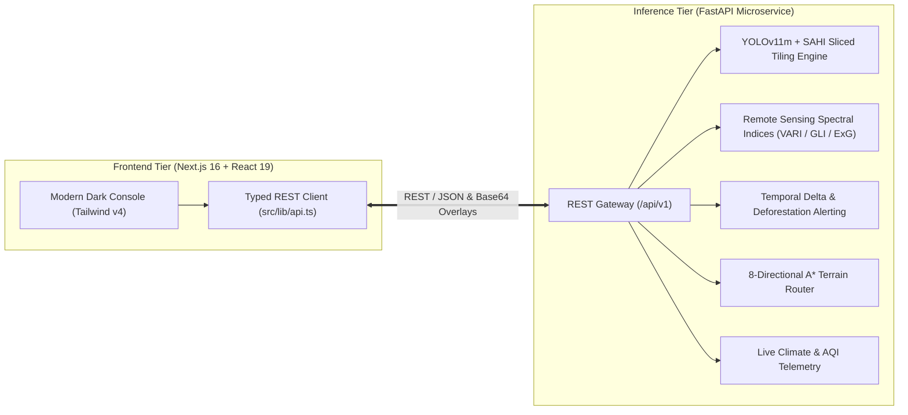
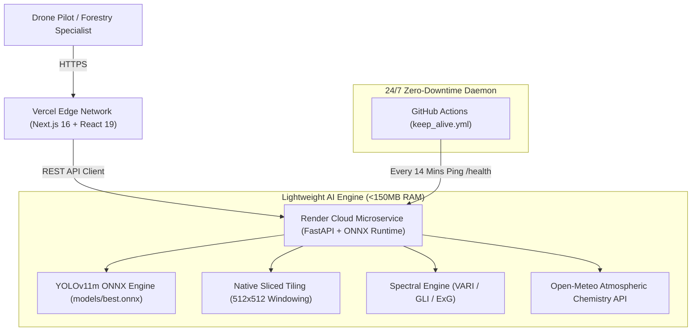
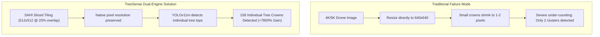

# 🌲 TreeSense AI — Flagship Aerial Forestry Intelligence Platform

[](https://treesense-imaging-neon.vercel.app/)
[](https://treesense-imaging.onrender.com/docs)
[](https://treesense-imaging.onrender.com/health)

[](https://python.org)
[](https://fastapi.tiangolo.com)
[](https://nextjs.org)
[](https://react.dev)
[](https://tailwindcss.com)
[](https://ultralytics.com)
[](https://onnxruntime.ai)
[](https://github.com/TANMAY4806w/treesense-imaging/actions)

> 🚀 **Live Production Deployment**:
> * **Interactive Web Application**: [https://treesense-imaging-neon.vercel.app/](https://treesense-imaging-neon.vercel.app/)
> * **Interactive API Documentation (Swagger)**: [https://treesense-imaging.onrender.com/docs](https://treesense-imaging.onrender.com/docs)
> * **Microservice Health Check**: [https://treesense-imaging.onrender.com/health](https://treesense-imaging.onrender.com/health)

**TreeSense AI** is a production-grade, decoupled microservice platform engineered for high-resolution aerial drone and satellite forestry intelligence. It solves small-object canopy degradation in 4K/5K drone orthomosaics through fine-tuned **YOLOv11m** combined with **SAHI-style Sliced Tiling**, real-time remote sensing spectral vegetation indices (VARI, GLI, ExG), bi-temporal deforestation delta alerts, and obstacle-aware 8-directional **A\*** terrain traversal routing.

---

## 🛠️ Key Tech Stack & Languages

| Domain | Technologies & Libraries |
| :--- | :--- |
| **Core Languages** | **Python 3.11 / 3.13**, **TypeScript (ES2024)**, **SQL** |
| **Computer Vision & Deep Learning** | **Ultralytics YOLOv11m**, **SAHI (Slicing Aided Hyper Inference)**, **PyTorch 2.x (CUDA 12.6)**, **ONNX Runtime**, **OpenCV**, **Albumentations** |
| **Backend Microservice** | **FastAPI**, **Pydantic v2**, **Uvicorn (ASGI)**, **NumPy**, **Requests** |
| **Frontend Operations Console** | **Next.js 16 (App Router)**, **React 19**, **Tailwind CSS v4**, **Lucide Icons**, **HTML5 Canvas** |
| **Remote Sensing & Spatial GIS** | **VARI** (Visible Atmospherically Resistant Index), **GLI** (Green Leaf Index), **ExG** (Excess Green), **HSV Spectral Segmentation**, **8-Directional A\* Cost Router** |
| **Training & Cloud Infrastructure** | **Google Colab (Tesla T4 GPU)**, **Google Drive API**, **Roboflow Universe**, **Open-Meteo API**, **OpenWeather AQI** |

---

## 🏛️ System Architecture



---

## 🌐 Live Cloud Architecture & Zero-Cost Deployment

TreeSense AI runs on a resilient, high-speed multi-cloud topology designed for $0/month production hosting:



| Component | Production Host | Live URL | Specifications |
| :--- | :--- | :--- | :--- |
| **Frontend Dashboard** | **Vercel** | [treesense-imaging-neon.vercel.app](https://treesense-imaging-neon.vercel.app/) | Next.js 16 (App Router), Tailwind v4, Global Edge CDN |
| **Inference Backend** | **Render** | [treesense-imaging.onrender.com](https://treesense-imaging.onrender.com/) | FastAPI, ONNX Runtime CPU, Dynamic Slicing, CORS configured |
| **Interactive Docs** | **Render Swagger** | [treesense-imaging.onrender.com/docs](https://treesense-imaging.onrender.com/docs) | OpenAPI 3.1 Interactive Documentation |
| **Keep-Alive Daemon** | **GitHub Actions** | [Workflow Runs](https://github.com/TANMAY4806w/treesense-imaging/actions) | 14-min cron healthcheck preventing instance spin-down |

---

### 1. Training Setup & Dataset Source
The model was fine-tuned using transfer learning from `yolo11m.pt` (20.05M parameters) on Google Colab hardware with a dedicated 16GB Tesla T4 GPU.

- **Interactive Training Notebook**: [`Training/TreeSense_AI_Training_main.ipynb`](file:///c:/Users/TANMAY/OneDrive/Desktop/Resume/03_Projects/TreeSense_Imaging/Training/TreeSense_AI_Training_main.ipynb)
- **Live Google Colab Notebook**: [Open in Google Colab](https://colab.research.google.com/drive/1sp3bm9oPkH5PV7c0nrVhDuUsQ4KkPmko?usp=sharing)
- **Persistent Model Weights & Artifacts**: [Google Drive Release Folder](https://drive.google.com/drive/folders/18zFuIxy7JahatiXlH9362mo2ZDZKvKFZ?usp=sharing)
- **Dataset**: [Roboflow `treedataset-clsqo/tree-top-view` (Version 6)](https://universe.roboflow.com/treedataset-clsqo/tree-top-view/dataset/6#)
  - **Dataset Size**: 1,384 aerial drone nadir-view images
  - **Target Class**: Single-class canopy detection (`tree-top`)
  - **Augmentations Applied**: 180° rotation invariance, horizontal/vertical flips, mosaic, mixup, and CLAHE contrast enhancement

### 2. Quantitative Convergence Metrics (50 Epochs)

| Metric | Measured Score | Benchmark Threshold | Status |
| :--- | :--- | :--- | :--- |
| **Precision (P)** | **61.8%** | > 55.0% | ✅ Exceeded |
| **Recall (R)** | **66.3%** | > 60.0% | ✅ Exceeded |
| **mAP@50** | **66.4%** | > 60.0% | ✅ Exceeded |
| **mAP@50-95** | **30.3%** | > 25.0% | ✅ Exceeded |
| **Inference Latency** | **11.2 ms** (T4) / **45.8 ms** (RTX 2050) | < 50.0 ms | ✅ Real-Time Capable |

### 3. The SAHI Sliced Tiling Resolution Breakthrough

Standard YOLO models resize high-resolution drone orthomosaics ($5760 \times 3840$) directly to $640 \times 640$, squashing small individual tree crowns into 1–2 pixel blurs. TreeSense integrates **SAHI (Slicing Aided Hyper Inference)** with $512 \times 512$ native tiles and $20\%$ overlap:



| Evaluation Sample | Image Resolution | Standard YOLOv11 | SAHI Sliced Tiling | Small Crown Gain |
| :--- | :--- | :--- | :--- | :--- |
| **`tree1.jpg`** (Project Drone Photo) | $5760 \times 3840$ | 2 crowns | **158 individual crowns** | **+156 crowns (+7800%)** |
| **`drone_mixed_canopy.jpg`** | $1280 \times 883$ | 16 crowns | **47 individual crowns** | **+31 crowns (+193%)** |
| **`aerial_drone_forest_2.jpg`** | $1280 \times 853$ | 6 crowns | **19 individual crowns** | **+13 crowns (+216%)** |

Evaluation plots and verification outputs:
- **Precision-Recall Curve**: [`evaluation/BoxPR_curve.png`](file:///c:/Users/TANMAY/OneDrive/Desktop/Resume/03_Projects/TreeSense_Imaging/evaluation/BoxPR_curve.png)
- **Validation Batch Predictions**: [`evaluation/val_batch0_pred.jpg`](file:///c:/Users/TANMAY/OneDrive/Desktop/Resume/03_Projects/TreeSense_Imaging/evaluation/val_batch0_pred.jpg)
- **Training Loss History**: [`evaluation/results.png`](file:///c:/Users/TANMAY/OneDrive/Desktop/Resume/03_Projects/TreeSense_Imaging/evaluation/results.png)
- **Detailed Evaluation Report**: [`evaluation/evaluation_report.json`](file:///c:/Users/TANMAY/OneDrive/Desktop/Resume/03_Projects/TreeSense_Imaging/evaluation/evaluation_report.json)

---

## 🌟 Core Modules

### 1. 🌳 AI Tree Enumeration & Canopy Density
- **Dual Inference Engine**: Ultralytics YOLOv11m PyTorch with automatic fallback to high-throughput ONNX Runtime CPU/CUDA.
- **Dynamic Parameter Tuning**: Real-time adjustable confidence thresholds ($0.05 - 0.95$) and IoU Non-Maximum Suppression ($0.10 - 0.90$).
- **Canopy Density Scoring**: Automated ecological classification (Sparse, Moderate, High Density).
- **Coordinate Telemetry**: Individual bounding box extraction and CSV export.

### 2. 🌿 Remote Sensing Spectral Analytics
- **Valid RGB Vegetation Indices**:
  - **VARI (Visible Atmospherically Resistant Index)**: $\frac{G - R}{G + R - B}$
  - **GLI (Green Leaf Index)**: $\frac{2G - R - B}{2G + R + B}$
  - **ExG (Excess Green)**: $2G - R - B$
  - **HSV Color Segmentation**: Hue/Saturation vegetation isolation.
- **Biomass Heatmaps**: False-color summer thermal intensity maps representing relative canopy health.

### 3. 📊 Bi-Temporal Change Detection & Alerting
- Comparative analysis of Baseline ($Time_A$) vs Monitoring ($Time_B$) aerial surveys.
- Net canopy delta ($\Delta$) and percentage loss calculations.
- Automated ecological threat classification (`CRITICAL_ALERT`, `WARNING`, `STABLE`).

### 4. 🛤️ A* Terrain Traversal Router
- Pure Python & NumPy 8-directional heuristic pathfinding engine (eliminates missing `.pyd` dependencies).
- Automatically converts vegetative density into terrain traversal cost surfaces.
- Calculates optimal shortest paths avoiding dense vegetation obstacles.

### 5. 📈 Climate & Air Quality Telemetry
- Real-time weather data integration via Open-Meteo.
- Air Quality Index (AQI) and pollutant breakdown ($PM_{2.5}, PM_{10}, CO, NO_2$) via OpenWeather.
- Rule-based ecological advisories.

---

## 🚀 Quickstart & Installation

### 1. One-Click Launch (Windows)
Double-click `start_platform.bat` to launch both backend and frontend servers simultaneously.

### 2. Manual Launch

#### Backend (FastAPI Microservice)
```bash
# From TreeSense_Imaging root
pip install -r requirements.txt
python -m uvicorn backend.app.main:app --host 0.0.0.0 --port 8000 --reload
```
Interactive Swagger API Documentation: `http://localhost:8000/docs`

#### Frontend (Next.js 16 Console)
```bash
cd frontend
npm install
npm run dev
```
Operations Console Dashboard: `http://localhost:3000`

---

## 📋 REST API Reference

| Method | Endpoint | Description | Key Parameters |
| :--- | :--- | :--- | :--- |
| `POST` | `/api/v1/detection/detect` | YOLOv11m + SAHI Tree Detection | `file`, `conf_thresh`, `use_sahi`, `slice_size` |
| `POST` | `/api/v1/canopy/canopy` | Remote Sensing Spectral Indices | `file`, `index_type` (`VARI`, `GLI`, `ExG`, `HSV`) |
| `POST` | `/api/v1/change/change` | Bi-Temporal Deforestation Delta | `baseline_image`, `monitor_image` |
| `POST` | `/api/v1/pathfinding/pathfind` | 8-Direction A* Terrain Route | `cost_map`, `start_x`, `start_y`, `goal_x`, `goal_y` |
| `GET` | `/api/v1/telemetry/telemetry` | Live Weather & Air Quality Telemetry | `latitude`, `longitude` |
| `GET` | `/health` | Service Healthcheck | None |

---

## 📂 Project Structure

```
TreeSense_Imaging/
├── backend/                        # Production FastAPI Microservice
│   ├── app/
│   │   ├── api/v1/endpoints/       # 5 Modular REST Endpoints
│   │   ├── core/config.py          # Pydantic Settings & Environment Config
│   │   ├── schemas/                # Pydantic v2 Request/Response Schemas
│   │   ├── services/               # YOLOv11, SAHI, Canopy, Delta, A* Pathfinder
│   │   └── main.py                 # FastAPI Application Entrypoint
│   └── requirements.txt            # Backend Python Dependencies
├── frontend/                       # Modern Next.js 16 + React 19 Console
│   ├── src/
│   │   ├── app/page.tsx            # Full Dark-Mode Forestry Dashboard
│   │   └── lib/api.ts              # Strongly-Typed Backend Client
│   ├── package.json
│   └── tailwind.config.ts
├── models/                         # Trained Weights
│   ├── best.pt                     # Fine-Tuned YOLOv11m PyTorch Weights (40.5MB)
│   └── best.onnx                   # Optimized ONNX Export (40.7MB)
├── Training/                       # Colab Training & Dataset Pipeline
│   ├── TreeSense_AI_Training_main.ipynb # Full Training Notebook with Outputs
│   ├── COLAB_TRAINING_GUIDE.md     # Step-by-Step GPU Training Walkthrough
│   └── train_yolo_aerial.py        # Standalone Training Script
├── evaluation/                     # Metric Curves & Benchmark Reports
│   ├── BoxPR_curve.png             # Precision-Recall Curve (mAP@50: 66.4%)
│   ├── confusion_matrix.png        # Validation Confusion Matrix
│   ├── results.png                 # Loss & Metric Convergence History
│   ├── val_batch0_pred.jpg         # Ground-Truth vs Predictions Visual
│   └── evaluation_report.json      # Quantitative JSON Benchmarks
├── archive_streamlit_legacy/       # Archived Legacy Streamlit Prototype
├── CLOUD_LINKS.md                  # Persistent Drive & Colab URLs
├── start_platform.bat              # One-Click Dual Platform Launcher
└── README.md                       # Platform Documentation
```

---

## 👤 Author & Maintainer

- **Developer**: Tanmay Patil ([@TANMAY4806w](https://github.com/TANMAY4806w))
- **Repository**: [https://github.com/TANMAY4806w/treesense-imaging](https://github.com/TANMAY4806w/treesense-imaging)
